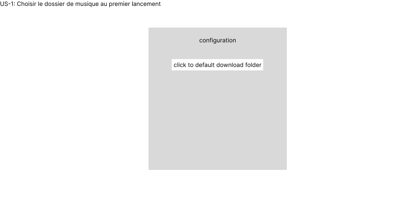
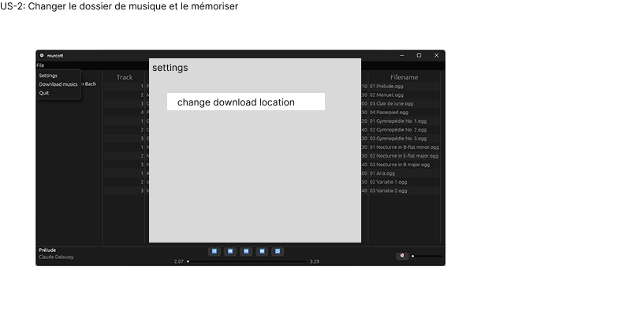
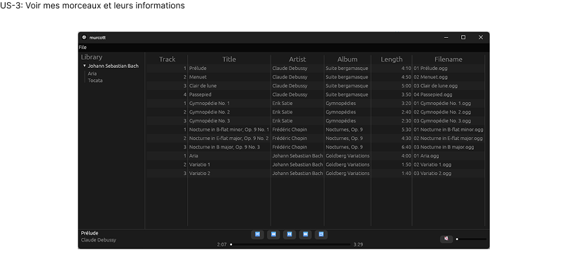

# UX/UI Analysis - Standalone Player

## 1. Introduction
This document is the UX/UI analysis of the three requested features of the standalone player (CdC point a): application startup, setting the location of local content, and browsing local content.

## 2. Application startup
### 2.1 First launch
- User goal: Select the music folder.
- Steps:
    - Check if it's the first launch
    - Store the music folder
    - Index the music inside it
- What the user sees: 
- Error case (user cancels, no folder chosen): The user can't skip this step, otherwise they cannot access the app. They have to choose a path where they have write rights.

### 2.2 Subsequent launches
- What happens (folder remembered? dialog shown?): If a folder is stored, the startup dialog is not shown.
- Error case (the folder no longer exists): If the stored folder is unset or no longer exists, the startup dialog is shown again (proposed behavior, see section 5).

## 3. Setting the location of local content
### 3.1 Initial choice
(see 2.1)

### 3.2 Changing it later
- Where the user goes (File > Settings): File > Settings
- Steps:
    - In the menu bar, go to File > Settings
    - In the settings, click the "Change music folder" button
- Mockup: 
- What changes in the track list afterwards: Only the library changes. The track list keeps the path of the file that is currently playing.
- Error case: If the change fails, an error message is shown and the previous folder is kept (proposed behavior, see section 5). If the stored folder is unset on the next launch, the startup dialog is shown.

## 4. Browsing local content
- User goal: Browse their local music. The library is sorted (B-tree) by artist, then each artist has albums, and then songs.
- Information shown: Title, Artist, Year, Length, File size
- Mockup: 
- Edge cases (missing tag, empty list, sorting):
    - If a song has no album, it is listed directly under the artist's name.
    - If a song has no artist, it goes into the artist list (still as a song).
    - If Year, Length or File size is missing, an empty cell is shown (proposed behavior, see section 5).
    - Sorting: by artist, then album, then track number.
    - If the track list is empty, play and skip are disabled and an "empty library" message is shown (proposed behavior, see section 5).